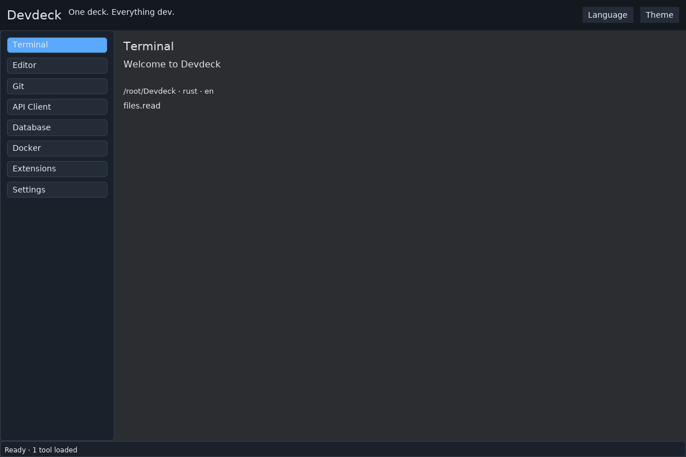

# Devdeck

**One deck. Everything dev.**

A native, 100% Rust desktop app aiming to replace the terminal, editor, Git client, API client, database manager, Docker/Kubernetes tools, toolchain manager, secrets manager and AI agent hub with one fast, extensible, multilingual workspace.

> Status: early foundation (Phase 0/1). The window, theming, command palette, en/vi runtime switch, typed tool schema, permission/audit plumbing and extension contribution types exist and are tested. Most tool modules are intentional skeletons. See [docs/progress.md](docs/progress.md).



## Build

```bash
cargo build --workspace
cargo test --workspace
cargo run -p devdeck-app
cargo run -p devdeck-cli -- doctor --lang vi
cargo run -p devdeck-xtask -- i18n-lint
```

Linux needs X11/Wayland, xkbcommon, fontconfig, freetype and ALSA development packages.

## Documentation

- [VISION.md](VISION.md) — product vision and constraints
- [docs/progress.md](docs/progress.md) — verified status, gaps and next steps
- [docs/adr/](docs/adr/) — architecture decision records
- [docs/security/threat-model.md](docs/security/threat-model.md) — threat model v1
- [CONTRIBUTING.md](CONTRIBUTING.md), [SECURITY.md](SECURITY.md)

## License

Dual-licensed MIT OR Apache-2.0. See `LICENSE-MIT` and `LICENSE-APACHE`.
