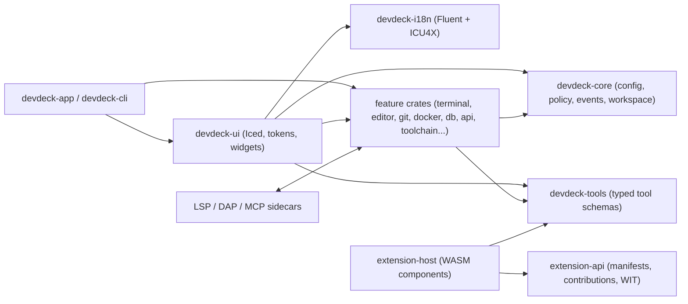
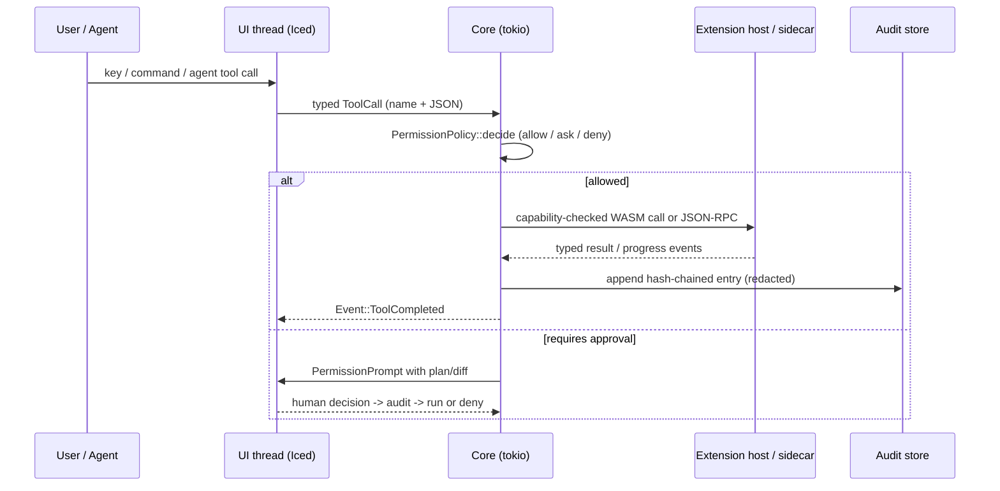

# Deliverable 2 — Technical architecture

## Principles

1. One-way crate dependencies: `core → tools → extension-api → feature crates → ui → app/cli`. Core never depends on UI.
2. Every capability is a typed tool with generated JSON Schema, permission level, risk level, CLI subcommand, MCP tool, localized display text and an audit entry.
3. Files are the source of truth; settings, workspaces and installation records are versioned, atomic and Git-friendly.
4. Deny-by-default capabilities; dangerous actions require explicit approval; all tool and agent actions are audited.
5. Reuse protocols and engines; do not reimplement Git, containers, DB servers, LSP/DAP or package managers.

## Module graph

## Subsystem boundaries (16)

| Subsystem | Owns | Public boundary | Placement |
| --- | --- | --- | --- |
| Application shell | windows, tabs, splits, palette, lifecycle | `Shell::run`, contribution rendering | UI process |
| Native UI | tokens, widgets, a11y glue | `Element<Message>`, theme tokens | UI thread only |
| Editor | rope buffer, Treesitter, decorations | `DocHandle::apply/snapshot` | UI process (active doc only) |
| LSP/debug | protocol clients, diagnostics, breakpoints | `LspClient`, `DapClient` [361][364] | sidecar processes |
| Terminal | PTY sessions, grid model, scrollback | `Terminal::new/resize/write` | UI model + PTY child process |
| Git | repo state, diffs, worktrees | `GitRepo` façade over core git | tokio/blocking pool |
| Container | Docker/Podman clients, compose | `ContainerClient` | daemon + CLI adapter |
| Database | connections, schema, read/write policy | `DbConnection`, typed rows | drivers + optional sidecar |
| API client | requests, collections, scripts | `RequestRunner`, typed tool | tokio |
| Tool installation | detection, plan, adapters, provenance | `ToolManager` (Deliverable 6 in `research/tool-management.md`) | external manager processes |
| Runtime/version | version resolution, shims | `RuntimeResolver` | user-scope shim dir |
| Configuration | JSON/YAML/TOML, schema validation, migrations | `ConfigStore::load/set/watch` | single writer, atomic |
| Plugin runtime | WASM components, capabilities | `ExtensionHost::load/call_tool/grant` [345][346] | supervised host process |
| Workflow engine | task graphs, automation | `Workflow::run` with approval | tokio |
| Project/workspace | detection, per-workspace state | `WorkspaceManager::detect` | UI/core |
| Storage/metadata | settings, audit, installation records | `Store::append_audit/verify_chain` | single writer |

## Process and data flow

The UI thread never performs blocking I/O; tokio channels carry bounded events, with coalescing for high-frequency terminal/grid updates.

## Plugin runtime decision

Primary: **WASM components in a separate extension-host process**, WIT world `devdeck:api@1.x`, WASI 0.2, capability-scoped imports, per-extension memory/fuel/epoch limits, restart with backoff[345][346]. Declarative `extension.toml` manifests remain the control plane (discovery, contributions, permissions, approvals, settings schema). Secondary: **out-of-process native JSON-RPC/stdio sidecars** for LSP, DAP and MCP[361][364][368][451]; the same permission policy applies. Rust `dylib` plugins are rejected (no stable cross-platform Rust ABI); manifests alone are not an execution runtime.

## Dependency and licence strategy

MIT/Apache-2.0-compatible allowlist enforced by `cargo-deny` in CI[459]. Exact-pinned direct dependencies, committed `Cargo.lock`. Incompatible-licence tools (e.g. GPL `cargo-binstall`) are invoked as external processes only. No webview, JS frontend or remote rendering. UI decision: keep Iced 0.14.0 pinned with `tokio`+`canvas`; GPUI 0.2.2 is blocked by a transitive build break, Slint 1.19 has AccessKit but a GPLv3/commercial licence incompatible with ADR 0004[302][304].

## Known architecture risks

Untrusted sidecars need OS-level sandboxing before general use; WIT/WASI churn needs pinning and shims; config must stay single-writer; approval fatigue can make prompts meaningless; performance targets are unmeasured. Full specification with per-subsystem APIs and diagrams: `research/architecture.md`.

## Sources

[302] https://crates.io/api/v1/crates/iced
[304] https://github.com/slint-ui/slint/blob/master/LICENSE.md
[345] https://docs.wasmtime.dev/api/wasmtime/component
[346] https://component-model.bytecodealliance.org/design/wit.html
[361] https://github.com/microsoft/language-server-protocol/blob/main/indexFormat/specification.md
[364] https://microsoft.github.io/debug-adapter-protocol
[368] https://modelcontextprotocol.io/specification/2026-07-28/server/tools
[451] https://modelcontextprotocol.io/specification/2026-07-28/basic/transports/stdio
[459] https://embarkstudios.github.io/cargo-deny/checks/licenses
