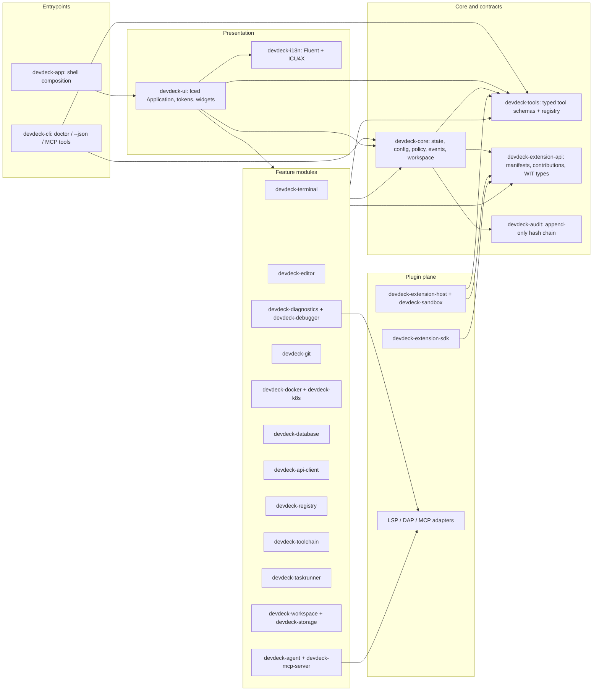
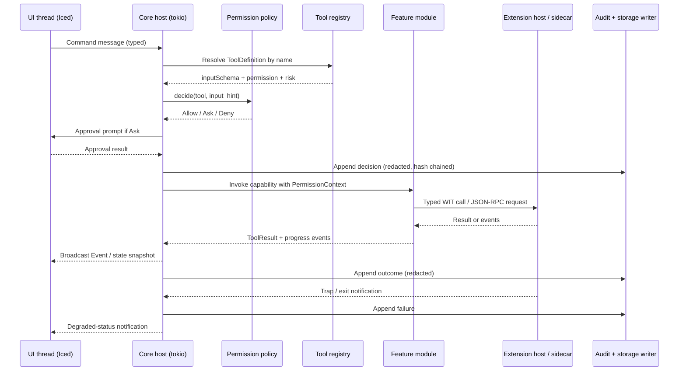
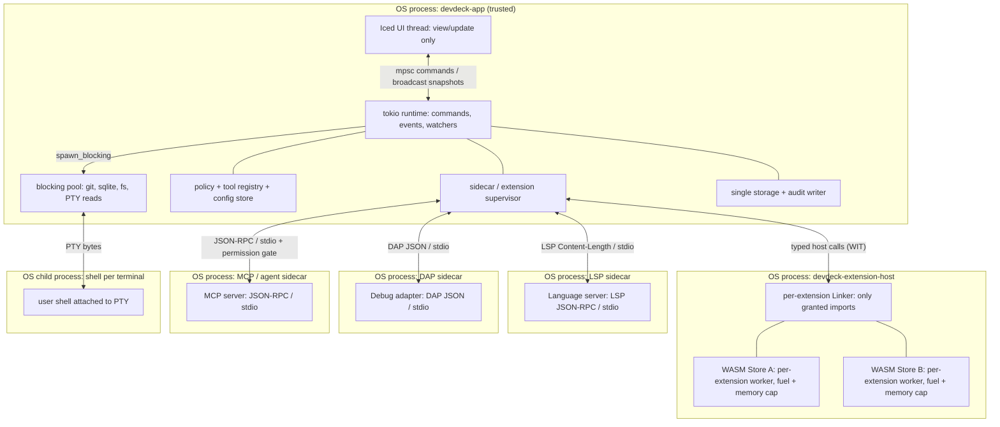

# Devdeck — modular architecture and plugin runtime

**Status:** research report, 2026-11-22. **Scope:** design only. No product file in `/root/Devdeck` was modified; this document and its citation ledger are the only writes.

**Method:** design starts from the verified Phase 0/1 scaffold (`docs/progress.md`, `docs/adr/0001`–`0004`, `VISION.md`, `AGENTS.md`). External technology claims were retrieved from official crate/specification documentation and registered in the dedicated ledger `research/.citations/architecture.json` at retrieval time. Statements marked **Analysis** or **Design decision** are architectural judgement, not measured facts. No benchmarks are claimed; the figures in `VISION.md` (cold start, idle RAM, fps, keystroke latency) remain unmeasured targets.

---

## 1. Executive summary

Devdeck should be one native host process built as a set of crates with one-way dependencies: `core` → `tools` → `extension-api` → feature crates → `ui` → `app`/`cli`. The existing workspace already contains the 28 skeleton crates and the Phase 0/1 foundation: native Iced shell, typed `files.read` tool with generated JSON Schema, deny-by-default policy types, SHA-256 hash-chained audit log, manifest/contribution types, and a draft WIT world. Terminal, editor, Git, API, database, Docker, toolchain, extension host, registry, MCP server and updater are explicitly not implemented yet (`docs/progress.md`), so this document defines their boundaries rather than describing existing code.

**Plugin recommendation (design decision):** primary = **WebAssembly components (WASI 0.2 world + versioned WIT `devdeck:api@1.x`) inside a separate `devdeck-extension-host` process**, with the declarative TOML manifest retained as the *control plane* for discovery, contributions, permissions and approvals. Secondary = **out-of-process native sidecars speaking versioned JSON-RPC over stdio** for LSP, DAP, MCP and other mature protocol servers. Rust `dylib` plugins are rejected; declarative manifests alone are not an execution runtime. This preserves ADR 0002 and ADR 0004.

**Process model (design decision):** one UI/core process (Iced event loop + tokio multi-thread runtime + blocking pool), one supervised extension-host process, one OS process per language/debug/MCP sidecar, one child shell per terminal PTY. Cross-boundary traffic is typed tool calls, capability-checked host imports and JSON-RPC; no UI thread ever performs I/O.

---

## 2. Baseline and non-negotiables inherited from the scaffold

- Iced 0.14.0 is pinned in `Cargo.toml` with the `tokio` and `canvas` features per ADR 0001; Iced's `tokio` feature exists as a documented feature flag [13], and Iced exposes an `Executor::spawn` abstraction for asynchronous work [127].
- ADR 0002 selects Wasmtime 51.0.0 components with versioned WIT worlds, capability permissions, fuel/memory/time limits, restart-on-trap, plus native JSON-RPC sidecars and Rhai for small automations. ADR 0003 selects Fluent + ICU4X; ADR 0004 selects MIT OR Apache-2.0 with `cargo deny` enforcement.
- `AGENTS.md` requires: no UI dependency in core, all blocking work on tokio, every feature registered through public contribution points, every capability a typed tool in `devdeck-tools`, secret redaction, atomic writes, versioned config migrations, and cross-platform builds. `VISION.md` adds local-first operation and app-owned directories under `~/.devdeck/...`.
- Existing concrete APIs to reuse: `AppConfig::load/save`, `PermissionPolicy::decide`, `detect_workspace`, `EventBus` (tokio broadcast), `ToolDefinition`, `ToolRegistry::to_mcp_json` with `inputSchema`/`outputSchema`/`annotations`, `ExtensionManifest::added_permissions`, `AuditLog::append` with hash chaining and redaction.

---

## 3. Architectural principles (Analysis)

1. **Core has no UI dependency.** Core owns state, configuration, policy, events, workspace discovery and the `Module` contract; it publishes facts, never views.
2. **Typed schema is the single source of truth.** A Rust input type derives JSON Schema via `schemars::JsonSchema` [61]; that schema feeds CLI, palette, MCP `tools/list` and extension tool metadata. MCP tools expose an `inputSchema` describing expected parameters [25].
3. **Config is the source of truth for behaviour, not a cache.** Runtime state is derived from layered config + workspace state + extension grants; writes go through one migration-aware store with atomic replacement.
4. **Deny by default at every boundary.** The same policy engine gates built-ins, extension exports and agent calls. WASI's capability model likewise starts with no ambient authority [67].
5. **Failure containment is structural.** Any untrusted or crash-prone component lives behind a process or WASM boundary; the host never relies on a plugin's goodwill.
6. **Offline-first.** Loading, editing, Git, terminal, local DB, local containers and installed toolchains must work with no network; the registry is an optional cache-fill source.
7. **Version everything crossing a boundary.** Config schema, WIT world, JSON-RPC protocol, workspace file format, audit format and sidecar specs each carry an explicit version.

---

## 4. Module graph



Dependency rule: arrows point from dependent to dependency. No arrow may be added from `core`, `tools`, `extension-api`, or any feature crate to `ui`; CI should enforce this with `cargo tree`/lint.

---

## 5. Subsystem specifications

The public API boundary of each subsystem is the only set of items other crates may call. Everything else is private to the crate. Each subsystem exports a `Module` implementation registering contributions through `devdeck-extension-api` (no private back doors).

### 5.1 Application shell

- **Responsibility:** compose the native window, startup sequence, module registry, command dispatch, shutdown/restart policy and global error presentation. Owns the lifecycle: load config → detect workspace → load modules → register tools/contributions → activate startup extensions → run event loop → drain audit and sidecars on exit.
- **Public API boundary:**
```rust
pub trait Module: Send + Sync {
    fn id(&self) -> &'static str;
    fn contributions(&self) -> Vec<Contribution>;
    fn activate(&mut self, ctx: &mut ModuleContext) -> Result<(), ModuleError>;
    fn deactivate(&mut self) -> Result<(), ModuleError>;
}
pub struct Shell;
impl Shell {
    pub fn run(config: AppConfig, modules: Vec<Box<dyn Module>>) -> Result<(), AppError>;
}
```
- **Dependencies:** `core`, `tools`, `extension-api`, `i18n`, `ui`, every feature module; the OS windowing stack only through `ui`.
- **Process / thread placement:** `main` thread creates the tokio runtime, then hosts the Iced event loop; activation runs as tokio tasks; shutdown uses `Runtime::shutdown_timeout` rather than indefinite waits [140].
- **Data owned:** window/tab/palette state, module registry, activation record. Persisted layout goes to `storage`, never to module-owned files.

### 5.2 Native UI

- **Responsibility:** render native widgets, theme tokens, resizable splits, IME/HiDPI input, keyboard-first navigation and localized labels; translate UI messages into commands and render state snapshots.
- **Public API boundary:** `iced::Application::view(&Self) -> Element<'_, Message>`, `update(&mut Self, Message) -> Command<Message>`, `subscription(&Self) -> Subscription<Message>`; `Theme` token API and `I18nKey → String` lookup. Widgets never call feature crates directly — only command messages.
- **Dependencies:** `core` (state/events), `tools` (palette entries), `i18n`, `extension-api` (contribution types). Iced's `tokio` feature is already selected [13]; `Executor` provides the async spawn hook [127].
- **Process / thread placement:** view/update on the UI thread (bounded, allocation-light); all I/O via commands to tokio tasks; expensive parsing/formatting via `spawn_blocking`, which is documented as running closures on a thread where blocking is acceptable [9].
- **Data owned:** view model snapshots, focus/keyboard state, theme tokens, pending command queue. No source of truth lives in UI state.

### 5.3 Editor

- **Responsibility:** text buffers, incremental syntax trees, edits/undo, diagnostics gutters, code lens and document versioning for LSP synchronisation.
- **Public API boundary:** `Editor::open(path) -> DocHandle`, `DocHandle::apply(rev: u64, edits: &[TextEdit]) -> Result<u64, EditError>`, `DocHandle::snapshot(rev) -> TextSnapshot`, `subscribe_diagnostics(doc) -> Stream<Diagnostic>`.
- **Dependencies:** `storage` (atomic autosave/recovery), `workspace` (path scoping), `tools` (`files.read`/`files.write` capabilities), `diagnostics` (LSP client), `i18n`. Tree-sitter is the incremental parsing engine: tree-sitter requires editing the old tree then re-parsing with it to share structure [38].
- **Process / thread placement:** keystroke handling and visible-range layout on UI thread; rope edits, parse and queries on tokio/blocking workers; LSP notifications on the sidecar's async task.
- **Data owned:** in-memory buffer revisions, syntax trees, undo stacks, cursor/selection state; autosaved scratch files under `~/.devdeck/editor/`.

### 5.4 LSP / debug

- **Responsibility:** discover language servers and debug adapters from workspace + extension contributions, manage their lifecycle, translate editor/diagnostic/breakpoint events to protocol messages and back.
- **Public API boundary:** `LspClient::start(SidecarSpec) -> LspHandle` with `did_open/did_change/diagnostics/capabilities`; `DapClient::start(SidecarSpec) -> DapHandle` with `launch/attach/set_breakpoints/stopped/stack_trace`. Both consume a typed `SidecarSpec` (program, args, env allowlist, protocol version, workspace root, timeout).
- **Dependencies:** `extension-api` (`Contribution::Language`, `Agent` style contributions), `workspace`, `tools`, `sandbox`, `audit`.
- **Process / thread placement:** every server/adapter is a separate OS process; tokio tasks own stdio framing (LSP `Content-Length` headers are required by the specification [17]; DAP defines JSON messages between tool and adapter [21]).
- **Data owned:** server capabilities, document versions, diagnostic lists, breakpoint/session state, per-server log ring buffer. Never server credentials — those come from `secrets`.

### 5.5 Terminal

- **Responsibility:** PTY sessions, shell profiles, resize, scrollback, ANSI parsing, search and shell integration hooks.
- **Public API boundary:** `Terminal::new(profile: ShellProfile) -> SessionId`, `write(id, bytes)`, `resize(id, PtySize)`, `subscribe_output(id) -> Stream<TerminalEvent>`, `close(id)`.
- **Dependencies:** `core` (policy), `tools` (shell commands as typed tools), `workspace` (initial cwd), `secrets` (env injection), `i18n`. `portable-pty` provides a cross-platform PTY API with runtime-selectable implementations [29].
- **Process / thread placement:** one child shell process per session; PTY read/write on blocking tasks; terminal state machine and parser on a worker, visible rows sent to UI as a bounded snapshot.
- **Data owned:** scrollback ring buffer (bounded), session metadata, shell profile choices; no shell history is persisted by Devdeck unless explicitly enabled.

### 5.6 Git

- **Responsibility:** repository discovery, status/diff/log, staging, commit, branches, fetch/pull/push and merge-conflict helpers, with dangerous operations routed through approval.
- **Public API boundary:** `GitRepo::open(path) -> RepoHandle`, `status()`, `diff(DiffSpec)`, `commit(CommitSpec)`, `remote_op(RemoteOp)`, `subscribe_changes()`. All methods accept a `PermissionContext` and emit `ToolCallRecord`.
- **Dependencies:** `git2` is the initial libgit2-backed implementation (Rust bindings to the libgit2 C library [45]); `gix` is an assessment-level alternative for a pure-Rust path, not yet adopted. `workspace`, `secrets` (credentials), `audit`, `i18n`.
- **Process / thread placement:** libgit2 calls are synchronous and run via `spawn_blocking` [9]; network remotes may additionally run in a sidecar if a later hardening phase requires process isolation.
- **Data owned:** repository handles, status/diff caches, conflict state; never mutates `.git/config` without a typed tool call and audit entry.

### 5.7 Container

- **Responsibility:** discover Docker/Podman endpoints, list/inspect containers and images, stream logs, start/stop/restart, compose-aware views.
- **Public API boundary:** `ContainerClient::connect(endpoint: Endpoint) -> Client`, `list_containers(filter)`, `logs(id, follow) -> Stream<LogChunk>`, `control(id, ContainerAction)`. `Endpoint` is config-owned (local socket, named pipe, TCP/SSH).
- **Dependencies:** `bollard`, which is an async Docker/Podman API client supporting local sockets/named pipes and version negotiation [57]; `tools`, `audit`, `workspace`.
- **Process / thread placement:** async client tasks on tokio; log streams are bounded channels into UI; no Docker daemon is embedded.
- **Data owned:** endpoint inventory cache, log buffers, container selection state; destructive actions (`docker rm`, prune) are high-risk tools requiring approval.

### 5.8 Database

- **Responsibility:** connections to SQLite/Postgres/MySQL-compatible sources, query editor execution, row streaming, schema browsing, saved queries and transaction boundaries.
- **Public API boundary:** `DbSource` (typed connection descriptor with secret reference, never a raw password), `DbConnection::connect(source) -> Conn`, `query(Query) -> RowStream`, `begin()/commit()/rollback()`, `schema()`.
- **Dependencies:** `sqlx` for async pooled SQL with Tokio runtime support and a runtime-agnostic SQLite driver [49]; `rusqlite` for embedded local metadata/backup work [53]; SQLite WAL format is the documented basis for concurrent local metadata access [104]. `secrets`, `tools`, `audit`, `workspace`.
- **Process / thread placement:** one tokio task per connection/pool; synchronous SQLite ops confined to blocking workers; destructive SQL is gated by the existing dangerous-input detector plus explicit approval.
- **Data owned:** pools/connections, query history with parameters redacted, saved queries in `storage`; result rows are streamed, not retained wholesale.

### 5.9 API client

- **Responsibility:** request collections, environments/variables, HTTP execution, auth flows, response viewer, SSE/WebSocket streaming and cURL import/export.
- **Public API boundary:** `RequestSpec` (method, URL template, headers, body kind, auth ref) + `ApiClient::send(spec, env) -> Response`, `stream(spec) -> Stream<Event>`; all auth values are `SecretRef`.
- **Dependencies:** `core` policy, `secrets`, `i18n`, `tools`, `storage`. Reuse a mature async HTTP client once its pinned license/version passes `cargo deny`; this report makes no unverified recommendation about a specific version.
- **Process / thread placement:** purely tokio async tasks; no UI-thread I/O; large response bodies stream to storage with size caps.
- **Data owned:** collections, environments, redacted history, response cache under `~/.devdeck/api/`.

### 5.10 Tool installation

- **Responsibility:** install/update/uninstall developer tools and extensions from the registry, verify checksums/signatures, resolve dependencies and keep an offline cache.
- **Public API boundary:** `InstallPlan` (id, version, platform, source, checksum), `Registry::resolve(req) -> InstallPlan`, `install(plan, ProgressSink)`, `uninstall(id)`, `list_installed()`.
- **Dependencies:** `extension-api` manifests, `sandbox`, `toolchain` (shims), `audit`, `config`. Everything installs under `~/.devdeck/...` per `VISION.md`.
- **Process / thread placement:** downloads and extraction on tokio tasks; extraction to temp dir + atomic rename; no PATH mutation without explicit consent.
- **Data owned:** installed manifest database, content-addressed cache, install receipts and rollback journal.

### 5.11 Runtime / version manager

- **Responsibility:** resolve language runtime versions per workspace, download/install them through `tool installation`, create app-owned shims and expose the resolved environment to terminals, tasks and sidecars.
- **Public API boundary:** `VersionResolver::resolve(tool, constraint, workspace) -> ToolVersion`, `activate(workspace, tool, version)`, `environment_for(workspace) -> EnvOverrides`.
- **Dependencies:** `workspace` (version files such as `rust-toolchain.toml`, `.nvmrc`, `.python-version` — detection rules are config-driven), `registry`, `tools`, `audit`.
- **Process / thread placement:** resolution is pure/async; environment overrides are injected at child-process spawn, never written globally without consent.
- **Data owned:** installed toolchain directory, per-workspace selection, shim registry; no permanent shell-profile edits.

### 5.12 Configuration engine

- **Responsibility:** layered settings (defaults → user → workspace → workspace-local), validation, live watching, atomic writes and forward migrations; the authoritative source for behaviour and policy.
- **Public API boundary:** `ConfigStore::load() -> ConfigSnapshot`, `get<T: DeserializeOwned>(key)`, `set(key, value, Scope)`, `watch() -> Stream<ConfigChanged>`, `migrate(from: u32, to: u32)`. Existing `AppConfig::load/save` with `schema_version`, `FutureVersion` rejection and v0→v1 migration is the seed.
- **Dependencies:** `tools` (policy keys), `extension-api` (settings schemas), `audit`. No feature crate writes config files directly.
- **Process / thread placement:** one tokio watcher; all writes serialised through the store's single writer task; atomic temp-file + rename as already implemented.
- **Data owned:** `~/.devdeck/config.json` and workspace `.devdeck/config.toml`; secrets are never stored here — only references.

### 5.13 Plugin runtime

- **Responsibility:** discover manifests, validate API ranges and contribution points, instantiate WASM components with only granted imports, route typed tool calls, enforce fuel/memory/time limits, supervise restarts and expose extension status.
- **Public API boundary:** `ExtensionHost::load(manifest, component_bytes) -> ExtensionId`, `enable/disable(id)`, `call_tool(id, name, input) -> Result<Value, ExtensionError>`, `grant(id, permissions, scope)`, `events() -> Stream<ExtensionEvent>`. WIT world `devdeck:api@1.x` is generated with `wasmtime::component::bindgen!` [4]; component embedder APIs and WIT-driven type mapping are documented by Wasmtime [1], and a WIT world describes exactly what a component provides and requires [3].
- **Dependencies:** `extension-api`, `tools`, `core` policy, `sandbox`, `audit`, `i18n`, Wasmtime. Wasmtime's component `Linker` supplies host imports and resolves semver-qualified names such as `a:b/c@0.2.1` [131].
- **Process / thread placement:** separate `devdeck-extension-host` OS process; one Wasmtime `Store` and worker thread per extension; `Engine` compiled once; calls enter via async host trampolines.
- **Data owned:** extension packages, per-extension state directories, grant records, trap/restart counters. Host never shares memory with a guest.

### 5.14 Workflow engine

- **Responsibility:** declarative task/workflow definitions (steps, dependencies, conditions, retries, timeouts), execution, cancellation, parallel scheduling and run history.
- **Public API boundary:** `WorkflowDef` (typed TOML/YAML schema + version), `WorkflowEngine::run(def, ctx) -> RunHandle`, `cancel(run_id)`, `subscribe(run_id) -> Stream<StepEvent>`.
- **Dependencies:** `tools` (steps are typed tool calls, so policy applies), `workspace`, `config`, `audit`, `i18n`.
- **Process / thread placement:** DAG scheduler on tokio; each step dispatched through the same tool gateway as UI/CLI/agent calls; blocking steps use `spawn_blocking` [9].
- **Data owned:** workflow definitions in workspace, run state machine, bounded logs; no implicit privilege escalation.

### 5.15 Project / workspace manager

- **Responsibility:** detect and open a workspace, identify its type, resolve roots of nested projects, gate trust and map workspace-scoped config/permissions.
- **Public API boundary:** `WorkspaceManager::detect(path) -> WorkspaceCandidate`, `open(candidate) -> Workspace`, `roots() -> &[PathBuf]`, `marker(kind) -> Option<PathBuf>`. The Phase 1 `detect_workspace` marker scan is the seed.
- **Dependencies:** `core` events, `config`, `tools`, `extension-api` (`ActivationEvent::WorkspaceType`). Cargo's own model treats a workspace as packages sharing one root manifest and lockfile [141], which is one detection case, not the only one.
- **Process / thread placement:** detection is cheap async filesystem probing on tokio; results are cached in core; UI renders only the snapshot.
- **Data owned:** workspace registry, trust decisions, per-workspace overrides, detected language/marker set.

### 5.16 Storage / metadata

- **Responsibility:** all durable non-config state: workspace index, editor recovery, tool/extension receipts, query history, audit log, caches and migration bookkeeping.
- **Public API boundary:** `Store::get_ns(namespace, key) -> Option<Value>`, `put_ns(...)`, `append_audit(entry)`, `verify_audit_chain()`, `migrate_schema(from, to)`, `vacuum/rotate()`.
- **Dependencies:** `rusqlite` for embedded local relational storage [53] with SQLite WAL mode where concurrent readers are needed [104]; `devdeck-audit` for the hash-chained JSONL log; `config` for paths and retention policy.
- **Process / thread placement:** single dedicated writer task owns all SQLite connections; readers get snapshots via channels; filesystem writes are synchronous but confined to blocking workers.
- **Data owned:** `~/.devdeck/state.sqlite*` and `~/.devdeck/audit.jsonl`; all writes atomic, migrations forward-only.

---

## 6. Plugin runtime evaluation

| Option | Security | ABI stability | Licensing | Cross-platform | Verdict |
| --- | --- | --- | --- | --- | --- |
| Rust `dylib` / `cdylib` loaded in-process | None: arbitrary native code and full host memory; Rust panics/UB can kill host | Rust crates produce target-specific dynamic libraries (`.so`/`.dylib`/`.dll`) [89], and Rust code with a different runtime instance counts as foreign code with unwinding hazards [89] — no stable cross-compiler Rust plugin ABI | Plugin dependency licenses become part of the host's distribution question; permissive policy would need per-plugin review (ADR 0004) | Needs per-OS builds and exact toolchain matching | **Reject** |
| WebAssembly components + WASI 0.2 + WIT world | Capability-based: no ambient authority; a component without an import cannot reach that resource [67]; fuel/epoch interruption is supported by Wasmtime [5] | WIT is the component IDL with typed worlds [71][3]; Wasmtime linkers resolve semver-qualified import names [131], giving a versioned, typed ABI | Wasmtime is `Apache-2.0 WITH LLVM-exception` [94], compatible with ADR 0004; plugins ship their own licensed artifacts | WASM artifact is platform-neutral; host capability implementations are per-OS | **Primary** |
| Declarative manifests only (TOML/JSON) | Safest for data-only contributions but *no isolation boundary* for code execution | Schema versioned by config; trivially stable | No runtime dependency | Trivially portable | **Control plane, not a runtime** |
| Out-of-process JSON-RPC sidecars | Process boundary contains crashes; filesystem/network reach still needs OS sandboxing for untrusted binaries (ADR 0002 risk) | JSON-RPC 2.0 is transport-agnostic with a stable version field [77]; MCP stdio launches a subprocess and exchanges JSON-RPC over stdin/stdout [108] | Each sidecar keeps its own license; distribution rules must be reviewed before bundling | stdio works on all targets; sandbox primitives differ (Windows job objects, macOS seatbelt, Linux Landlock/seccomp) — **Analysis** | **Secondary** |

**Recommendation (design decision):** adopt the WASM component runtime as the only general-purpose extension mechanism, with the manifest as declarative metadata for discovery, contributions and permissions. Keep out-of-process JSON-RPC sidecars for protocol servers and legacy binaries. Do not expose raw dylibs in 1.0. The ADR 0002 Rhai choice remains valid for small in-host automations only if it is itself granted a resource budget; this report does not add a new host-language surface.

**WIT world shape (design decision):**
```wit
package devdeck:api@1.0.0;

interface tools {
  record tool-input { name: string, arguments: string }
  record tool-output { payload: string, content-type: string }
  invoke: func(input: tool-input) -> result<tool-output, string>;
}

world extension {
  import devdeck:api/tools@1.0.0;      // capability checked by linker
  import wasi:io/streams@0.2.0;
  export activate: func(ctx: string) -> result<_, string>;
  export deactivate: func() -> _;
}
```
The host installs imports selectively: an extension that declares no `Network` permission gets no network import instantiated; this mirrors WASI's capability model [67]. World versions are semver-qualified in the linker [131], so `1.0.x` guests can run against a host providing `1.0.0` without recompilation; breaking API changes require a new world and a shim.

---

## 7. Cross-cutting design

### 7.1 Core vs sidecar process split (Design decision)

- **In core process:** configuration, policy, event bus, typed tool registry, workspace detection, UI state, metadata writer, Wasmtime *supervision* client. These are trusted, cheap and need low-latency access to state.
- **In extension host process:** all third-party WASM components. It receives an allowlist of host imports per extension; it cannot see UI memory or host secrets.
- **In sidecar processes:** language servers (LSP), debug adapters (DAP), MCP agents and any third-party native binary. LSP and DAP deliberately externalise tooling into adapters [17][21]; MCP stdio likewise launches servers as subprocesses [108].
- **In child shells:** every terminal session. A shell is interactive user code, never trusted host code.
- **Rule:** a component is moved to a sidecar if it is (a) third-party native code, (b) crash-prone, (c) licence-incompatible with in-process distribution (ADR 0004), or (d) needs a different runtime. Conversely, do not add a process solely for async: tokio tasks are cheaper and typed.

### 7.2 Tokio async boundary (Design decision)

One multi-thread tokio runtime is created before the Iced loop. UI → core commands are `mpsc`; core → UI facts are `broadcast` (the existing `EventBus`). Blocking libraries (git2, synchronous SQLite, filesystem walks, PTY reads) use `spawn_blocking` [9]; the runtime's blocking pool and shutdown semantics are documented [140]. Sidecar stdio framing and Wasmtime async calls run as tokio tasks; CPU-bound WASM work is bounded by fuel [5] and executed on dedicated worker threads. No `std::sync` mutex is held across `.await`; UI receives bounded snapshots, never live handles.

### 7.3 Typed tool schema as single source of truth (Design decision)

```
Rust input struct (derive JsonSchema)
        │  schemars::schema_for!  [61]
        ▼
ToolDefinition { input_schema, output_schema, permission, risk, ... }
        │  ToolRegistry  (existing devdeck-tools)
        ├── CLI subcommand + --json
        ├── command palette / keybinding
        ├── MCP tools/list with inputSchema/outputSchema/annotations [25]
        └── extension tool contributions (same Contribution types)
```
One canonical `namespace.name` (lowercase) is the identity; duplicate names are rejected by the existing registry. Canonical names/descriptions remain English per ADR 0003; localization is display-only. A schema change is a versioned change to the tool, not a copy edit in four surfaces.

### 7.4 Config as source of truth (Design decision)

All policy, endpoint lists, theme/locale, workspace overrides, extension grants and tool settings live in versioned config under `~/.devdeck/`. The store is the only writer; every mutation emits `ConfigChanged` on the event bus and an audit entry for security-relevant keys. Runtime caches (syntax trees, repositories, pools) are rebuildable and never authoritative. Config writes are atomic (temp + rename, already implemented) and reject unknown future schema versions, matching the existing `ConfigError::FutureVersion` behaviour.

### 7.5 Workspace detection (Design decision)

Detection order: explicit `.devdeck/workspace.toml` → nearest recognised manifest (`Cargo.toml`, `package.json`, `pyproject.toml`, `go.mod`, `pom.xml`, `composer.json`, `Gemfile`, `compose.yaml`) → enclosing Git worktree root → process CWD. Nested roots are returned as a list; the workspace manager records which detector fired so results are explainable in the UI. Cargo workspaces are one concrete case where a root manifest and shared lockfile define membership [141]. Extension-contributed detectors register through `Contribution::Language`/workspace activation events, never by hard-coded paths in core.

### 7.6 Extension permissions (Design decision)

Manifest declares `Permission::{Fs, Network, ProcessSpawn, Env, Secrets, Clipboard, Database, AgentAccess}` (already typed in `extension-api`). On install/update: parse → validate `devdeck_api` semver range [112] → compute `added_permissions` (already implemented) → show a localized diff → require explicit user approval → store a workspace-scoped grant. At runtime the extension host constructs a per-extension linker containing only the granted imports; WASI components begin with no ambient authority [67]. `Ask` decisions route to the UI prompt; `Deny` produces an audit entry. Revocation takes effect at next activation; active instances are terminated. High-risk grants (process spawn, secrets, agent access) require re-approval per workspace and expire on manifest change.

### 7.7 Audit and logging (Design decision)

Two distinct channels: `devdeck-audit` writes an append-only, SHA-256 hash-chained JSONL record for every tool call and policy decision with actor (`Human`/`System`/`Agent`/`Extension`), permission, risk and outcome — the Phase 1 implementation already redacts secrets and verifies chain breaks. `tracing` emits operational logs (no secrets, no raw arguments) to a rotating local sink; telemetry is off unless explicitly opted in (ADR 0003/`VISION.md`). Every sidecar/extension event carries a correlation ID so a UI action can be traced across process boundaries. Audit retention/rotation is a storage responsibility, not a plugin privilege.

### 7.8 Crash isolation (Design decision)

WASM: per-extension `Store`, memory limits, fuel and epoch deadlines — Wasmtime documents deterministic fuel and non-deterministic epoch interruption strategies [5] — trap converted to `ExtensionEvent::Trapped`, restart with exponential backoff and a cap, persistent state confined to the extension's own directory. Native sidecars: supervisor detects exit, surfaces last stderr lines (redacted) in the Extensions panel, and restarts only on user action or a bounded retry policy. The UI process never restarts because an extension died. A crashing sidecar cannot corrupt config because only the core writer task writes config.

### 7.9 Offline operation (Design decision)

All P0 workflows (terminal, editor, Git local ops, database, API against local endpoints, containers against local socket, installed toolchains) require no network. Registry downloads, extension installation and remote Git operations are explicitly online features with a local content-addressed cache and a clear offline error. No feature may phone home for entitlement, telemetry or schema updates. ADR 0003's canonical English tool names stay stable offline; locale packs are installed artifacts.

### 7.10 Upgrade and migration (Design decision)

- **Config:** `schema_version` + forward-only `migrate(n → n+1)`; unknown future versions are rejected rather than downgraded; atomic writes always.
- **Workspace files:** versioned `.devdeck/*.toml` with the same migration discipline; backups written before format bumps.
- **Extension API:** WIT world version in package name (`devdeck:api@1.0.0`); semver-compatible host imports resolved by the linker [131]; two-minor-version deprecation window per ADR 0002; breaking change = new ADR + compatibility shim.
- **Sidecars:** `SidecarSpec.protocol_version` negotiated at launch; unsupported versions fail closed with a localized message.
- **Tool installation:** versioned receipts + rollback journal; uninstall restores previous shim state.
- **Audit format:** append-only; format changes create a new file generation and chain continuity record rather than rewriting history.

---

## 8. Event and data flow



Data flow rules: commands flow down (UI → core → module → plugin), facts flow up (plugin → module → core → UI), audit records flow sideways to the single writer. No plugin receives a UI handle or a config writer handle.

---

## 9. Process isolation



Boundary guarantees (design intent, not yet implemented): (1) extension.host has no UI socket, (2) every sidecar launch includes a permission allowlist and workspace root, (3) only the core writer task may write config/state/audit, (4) all child processes are reaped on host shutdown with a timeout.

---

## 10. Reuse and phase mapping (Design decision)

| Phase | Subsystems landed | Reuse existing crates / upstream |
| --- | --- | --- |
| 2 | terminal, task runner, extension-host MVP, storage skeleton | `portable-pty` [29], tokio blocking pool [9], existing `extension-api` manifest types, Wasmtime component API [1] |
| 3 | Git, declarative UI panels, workspace manager, config engine | `git2` [45], existing `AppConfig`/`detect_workspace`/`EventBus`, Iced features [13] |
| 3.5 | MCP server, tool gateway | existing `ToolRegistry::to_mcp_json` with MCP schemas [25], JSON-RPC framing [77], MCP stdio [108] |
| 4 | containers, tool installation, runtime manager, secrets | `bollard` [57], app-owned install dirs, semver ranges [112] |
| 4.5–5 | API client, database | `sqlx` [49], `rusqlite` [53], SQLite WAL [104] |
| 6–6.5 | editor, LSP/DAP, agent panel | tree-sitter incremental parsing [38], LSP [17], DAP [21] |
| 7+ | hardening, registry, P1/P2 modules | sandbox per OS, audit verification, extension world `1.x` compatibility |

Licensing gate: every new direct dependency must satisfy ADR 0004 and `cargo deny check`; Wasmtime's `Apache-2.0 WITH LLVM-exception` [94] is compatible with the dual MIT/Apache-2.0 host.

---

## 11. Top risks (Analysis)

1. **Component Model churn.** WASI 0.2/0.3 and WIT specifications evolve; pin Wasmtime/wit-bindgen versions, keep one WIT world per API major, and budget for shims (also an ADR 0002 risk).
2. **Sidecar sandbox gap.** JSON-RPC sidecars are native processes; a process boundary alone is not a security boundary against malicious binaries. OS-level sandboxing is required before untrusted sidecars are allowed (ADR 0002 lists this explicitly).
3. **Iced 0.14 limits.** No upstream screen-reader tree and pre-1.0 API churn (ADR 0001); editor/terminal widgets and accessibility tree must be built or contributed upstream.
4. **Config/write contention.** Multiple features must never write settings directly; a single writer task is mandatory, with atomic migration (see existing `AppConfig::save`).
5. **Tool-schema drift.** If any surface hand-writes a schema instead of deriving it from the Rust type, the "single source of truth" guarantee is lost; enforce with tests against `to_mcp_json`.
6. **Dangerous-operation approval fatigue.** High-risk tool calls must stay rare and explicit; otherwise users disable prompts and the audit chain records consent that was not informed.
7. **Unmeasured performance.** All latency/RAM targets are unverified; measure before claiming, and keep fuel/time caps from becoming visible input lag.
8. **Crash-restart loops.** A deterministic trap can restart forever; require backoff caps and operator-visible degraded state.

---

## Sources

[1] https://docs.wasmtime.dev/api/wasmtime/component
[3] https://component-model.bytecodealliance.org/design/worlds.html
[4] https://docs.wasmtime.dev/api/wasmtime/component/macro.bindgen.html
[5] https://docs.wasmtime.dev/examples-interrupting-wasm.html
[9] https://docs.rs/tokio/latest/tokio/task/fn.spawn_blocking.html
[13] https://docs.rs/crate/iced/latest/features
[17] https://microsoft.github.io/language-server-protocol/specification
[21] https://microsoft.github.io/debug-adapter-protocol
[25] https://modelcontextprotocol.io/specification/2026-07-28/server/tools
[29] https://docs.rs/portable-pty
[38] https://github.com/tree-sitter/tree-sitter/blob/master/docs/src/using-parsers/3-advanced-parsing.md
[45] https://docs.rs/git2/latest/git2
[49] https://docs.rs/sqlx/latest/sqlx
[53] https://docs.rs/rusqlite/latest/rusqlite
[57] https://docs.rs/bollard
[61] https://docs.rs/schemars/latest/schemars/derive.JsonSchema.html
[67] https://wasi.dev/security
[71] https://component-model.bytecodealliance.org/design/component-model-concepts.html
[77] https://www.jsonrpc.org/specification
[89] https://doc.rust-lang.org/reference/linkage.html
[94] https://crates.io/crates/wasmtime
[104] https://www.sqlite.org/walformat.html
[108] https://modelcontextprotocol.io/specification/2026-07-28/basic/transports/stdio
[112] https://docs.rs/semver
[127] https://docs.rs/iced/0.14.0/iced/trait.Executor.html
[131] https://docs.wasmtime.dev/api/wasmtime/component/struct.Linker.html
[140] https://docs.rs/tokio/latest/tokio/runtime/struct.Runtime.html
[141] https://doc.rust-lang.org/cargo/reference/workspaces.html
