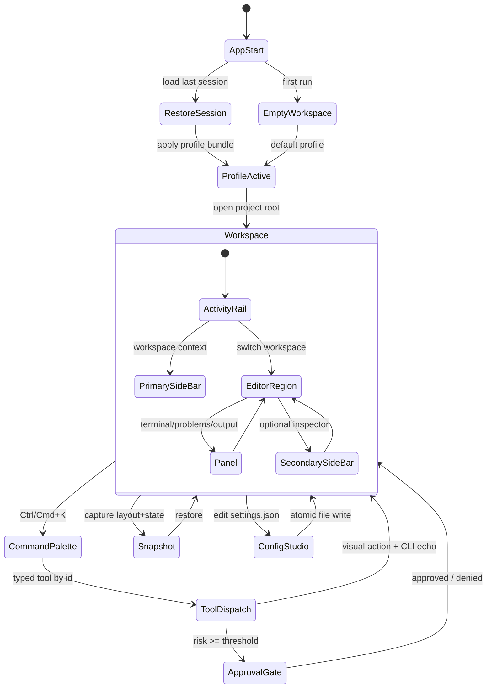

# Devdeck — UI/UX Specification

Status: research deliverable (Phase 0/1 design input). Scope: interaction and information architecture for all ten workspaces of a native, 100% Rust desktop application. This document specifies *what to build and how it behaves*; it does not implement product code.

## 0. How to read this document

- Statements tagged **DESIGN** are this specification's own decisions; they carry no external citation because they are proposals, not reported facts.
- Statements with a trailing `[n]` report a pattern documented by an external source, cited to the official docs in [Sources](#sources). Competitor references are used as *evidence that a pattern is established*, not as a mandate to copy.
- Product constraints (native Rust core, no webview, design tokens, Git-friendly config, keyboard-first) come from `VISION.md`, `docs/adr/0001-ui-framework.md` and `docs/design/tokens.md` in this repository; those are local facts, cited by file name rather than `[n]`.
- The current shell is a header + single text sidebar + content area + status bar, with a modal command palette and three token-based themes (`docs/screenshots/phase1-shell.png`, `crates/ui/src/lib.rs`). This spec evolves that shell into a multi-region workbench; every such evolution is tagged **DESIGN**.

## 1. Design principles

1. **Files are the source of truth.** Every visual edit writes a plain-text, diffable file; the UI never keeps a privileged copy of state. This mirrors how VS Code stores settings in JSON that can be edited either as text or through a graphical editor [6], and how Kubernetes configuration files live in source control and are applied with `kubectl apply` [18].
2. **One capability, many surfaces.** Each capability is a typed tool that exposes a visual action, an equivalent CLI command, a palette entry and permission/risk metadata (`VISION.md`). **DESIGN:** every workspace action must display its exact CLI equivalent in a "command echo" strip so the visual and command-line paths are provably the same operation.
3. **Keyboard-first, pointer-complete.** Anything reachable by mouse is reachable by keys with a visible focus indicator; VS Code lets users perform most tasks from the keyboard [4], and WCAG 2.4.7 requires a visible keyboard focus indicator [11].
4. **Preview before mutation.** Destructive or hard-to-reverse operations show a diff or plan first: `git diff` shows what would be staged [22], and `kubectl diff` previews what `apply` will change [18].
5. **No dead ends.** Errors are actionable, long operations are cancellable, and reversible actions never use a blocking modal.
6. **Local-first and private.** Config is version-controlled by choice, secrets are references, and nothing syncs to a cloud by default (`VISION.md`). Postman likewise keeps local variable values out of its cloud unless the user explicitly shares them [14].

## 2. Global navigation structure

### 2.1 Shell wireframe (DESIGN)

VS Code divides its workbench into six named areas — Editor, Primary Side Bar, Secondary Side Bar, Status Bar, Activity Bar and Panel — and restores the folder, layout and open files on restart [1]. Devdeck adopts an analogous frame, mapped to the existing tokens and sidebar component.

```
┌──────────────────────────────────────────────────────────────────────┐
│ TITLE BAR  Devdeck · [profile ▾]      [⌘K palette] [Lang] [Theme] [—][□][×] │  <- 28px-ish header
├────────┬────────────────────┬───────────────────────────────┬────────┤
│ ACT.   │ PRIMARY SIDE BAR   │ WORKSPACE / EDITOR REGION     │ SECOND-│
│ RAIL   │ (context per       │                               │ ARY    │
│  (48)  │  workspace)        │  ┌────────┬────────┐          │ SIDE   │
│        │                    │  │ tab A  │ tab B  │  splits  │ BAR    │
│ ▣      │ ▸ search/filter    │  ├────────┼────────┤          │ (opt.) │
│ ⌘      │ ▸ tree / list      │  │        │        │          │        │
│ ⎇      │ ▸ details/inspector│  │        │        │          │        │
│ ▤      │                    │  └────────┴────────┘          │        │
│ ◫      │                    │                               │        │
│ ⚙      │                    │                               │        │
├────────┴────────────────────┼───────────────────────────────┴────────┤
│ PANEL (terminal / problems / output / logs) — dock bottom, left or right │
├──────────────────────────────────────────────────────────────────────┤
│ STATUS BAR  Ready · branch · env · profile · progress · notifications │  <- STATUS_HEIGHT
└──────────────────────────────────────────────────────────────────────┘
        ┌───────────────────────────────┐
        │ COMMAND PALETTE (overlay)     │  <- Ctrl/Cmd+K, centered, dismissed by Esc
        │ > query…                      │
        │   label            hint       │
        └───────────────────────────────┘
```

**DESIGN decisions for the shell:**

- The Activity Rail is a compact, icon-and-label strip pinned to the far left; it is the only persistent global navigation. The existing `sidebar()` component (fixed `SIDEBAR_WIDTH = 200`) becomes the Primary Side Bar; the rail is a new narrow component that still uses only `Tokens`.
- Ten workspaces are grouped into rail entries: Project, Editor, Terminal, Git, Docker, Database, API, Tools, Config, Environment. Their labels come from the Fluent bundles (`locales/en/ui.ftl`); **DESIGN:** add the missing keys (`nav-project-explorer`, `nav-tool-center`, `nav-config-studio`, `nav-environment`) while preserving en/vi parity.
- The bottom Panel is shared across workspaces (terminal, problems, output, logs) and can be moved left/right, matching VS Code's movable Panel [1][2]. The existing status bar (`STATUS_HEIGHT = 28`) gains right-aligned indicators (branch, environment, profile, background task count).
- The command palette becomes a true centered overlay instead of the current in-flow modal panel; VS Code's Settings editor and Profiles editor likewise open as modal overlays over the editor area [6][7].

### 2.2 Navigation and state model (DESIGN)



**Config precedence (DESIGN):** built-in defaults < user settings (`~/.devdeck/settings.json`) < active profile bundle (`~/.devdeck/profiles/<name>/`) < workspace settings (`<project>/.devdeck/settings.json`) < transient snapshot overlay. Workspace settings override user settings in VS Code and are stored in a project folder for version control [6]; profiles are switchable, shareable bundles of settings, keybindings and extensions [7]. The UI always shows the *effective* value and which layer supplied it — Configuration Studio makes this layer stack explicit instead of hiding it.

## 3. Shared component vocabulary (derived from design tokens)

All visual components consume only the tokens already defined in `crates/ui/src/lib.rs` (`Tokens`, `SPACE_*`, `RADIUS`, `BODY_SIZE`, `SIDEBAR_WIDTH`, `STATUS_HEIGHT`); the repository states that no widget hard-codes colors (`docs/design/tokens.md`). The W3C Design Tokens Format defines named, typed `$value` tokens and aliasing by path [10]. **DESIGN:** export the palette and spacing scale as a DTCG-compatible JSON file under `~/.devdeck/tokens/` so themes are portable and versionable, while the Rust `Tokens` struct remains the runtime source.

| Token (source value) | Component(s) | Usage rule (DESIGN) |
|---|---|---|
| `background` #14181f / #f5f7fa / #000 | App frame | Root window fill; never used for interactive controls |
| `surface` #1b212b / #fff / #0a0a0a | Panel, SideBar, StatusBar, Dialog | Panel chrome; `panel_style` already applies it |
| `surface_alt` #242c38 / #eaeff5 / #1a1a1a | ListRow selected/hover, Palette result, Tab inactive | Secondary elevation; selected sidebar item already uses `accent`, hover uses `surface_alt` |
| `border` #354050 / #c8d2df / #ffff00 | Panel, Button, Input, Divider | 1px border at `RADIUS = 6`; high-contrast uses yellow border |
| `text` / `text_muted` | Label, Hint, Breadcrumb, Caption | Body text at `BODY_SIZE = 14`; hints at `BODY_SIZE - 2`; palette input 18 |
| `accent` #5ba8ff / #1c63c8 / #00ffff | FocusRing, ActiveTab, SelectedNav, Progress fill | One accent per theme; selection and focus only |
| `danger` #ff6b6b / #b02020 / #ff5555 | DestructiveButton, ErrorBanner, DiffRemoved | Reserved for irreversible actions and errors |
| `SPACE_XS/SM/MD/LG` = 4/8/12/16 | all layouts | Four-step spacing scale; no arbitrary pixel gaps |
| `SIDEBAR_WIDTH = 200`, `STATUS_HEIGHT = 28` | SideBar, StatusBar | Fixed shell metrics; rail is a new derived narrow metric |
| `RADIUS = 6`, `BODY_SIZE = 14` | all rounded controls, all body text | Single radius and type scale |

**Component inventory (DESIGN).** Existing: Sidebar, StatusBar, CommandPalette. To add, all token-only: ActivityRail, IconButton with accessible label, Tab/TabStrip, Panel/Dock, SplitPane with keyboard resize, VirtualTree/VirtualList (the Iced spike proved windowing math, not production widgets — ADR 0001), Breadcrumb, Toolbar, FormField, Toggle, Table, DiffGutter, CodeEditorSurface, TerminalSurface, ProgressBar, Spinner, ApprovalDialog, Toast/Notification, EmptyState, Badge. Theme switch previews colors live before applying, as VS Code's color-theme picker previews with arrow keys and persists the choice in settings [19].

**Themes and motion (DESIGN).** Ship the three existing palettes (Dark/Light/HighContrast). Add duration tokens (`motion-fast`, `motion-normal`) and honor OS "reduce motion": WCAG 2.3.3 says motion triggered by interaction must be disableable [21]. Reduced-motion work is already flagged as Phase 7 in `docs/design/tokens.md`; this spec makes it an accessibility blocker before 1.0. Focus indicators must meet WCAG 2.4.7 [11] and controls/graphics at least 3:1 contrast under WCAG 1.4.11 [20].

## 4. Cross-cutting interaction patterns

### 4.1 Command palette and keybindings

- **DESIGN:** `Ctrl/Cmd+K` opens the overlay; typing filters `label`, `hint` and `keywords`; arrows move, Enter runs, Esc closes. The shipped `normalize_search()` already makes matching diacritic-insensitive ("viet" finds "việt"), which the UI must surface as a hint for Vietnamese users.
- **DESIGN:** results are ranked by workspace scope first, then recency; a `>` prefix means commands, a path prefix means files, an `@` prefix means settings/symbols.
- Keybindings are editable and stored as text. VS Code's Keyboard Shortcuts editor lets users change, remove and reset shortcuts, search by command or key, detect conflicts, and install keymap extensions [4]; JetBrains IDEs copy a predefined keymap before editing and let users find an action by pressing its shortcut [23]. **DESIGN:** ship `~/.devdeck/keybindings.json` with presets (default, VS Code-like, JetBrains-like), chord support, a `when` context per binding, and a conflict detector; the binding always calls the same typed tool id as the palette entry.

### 4.2 Diff review

- **DESIGN:** every diff has unified and side-by-side modes; changed lines are selectable; stage/unstage operates on a hunk or a single line. The Git workspace shows worktree-vs-index, index-vs-HEAD and commit-vs-commit, matching the forms of `git diff` [22]; the editor and CLI Git operate on the same repository with no import/sync step [9].
- **DESIGN:** the diff footer shows the exact CLI command (`git diff -- <path>`, `git add -p`, `git diff --cached`); clicking it copies the command. Conflict resolution opens a three-way editor with "accept ours/theirs/both" and always writes the file on disk.

### 4.3 Approval prompts

- **DESIGN:** risk tiers map to the typed tool's permission/risk metadata (`VISION.md`). Low-risk/reversible actions proceed with a toast; medium-risk actions show a compact confirmation listing target, exact command and blast radius; high-risk/destructive actions require typing a confirmation token and default to "Deny".
- Preview before apply is the established pattern: `git diff` previews what would be staged [22] and `kubectl diff` previews changes before `apply` [18]. **DESIGN:** "Remember for this session/project" scopes a permission grant, never a global bypass; every approval (and denial) is written to the append-only audit log (`VISION.md`).

### 4.4 Progress and cancellation

- **DESIGN:** any operation over ~200 ms shows a ProgressBar in the status bar plus a streamable detail panel; all long operations take a cancellation token, keep partial output, and expose "Retry" as an idempotent re-run of the same command echo. Cancel is always `Esc` when focus is in the task panel.
- Container log views stream output in real time and support search with match highlighting [15]. **DESIGN:** reuse that stream+search widget for terminal, logs, test and migration output.

### 4.5 Errors and notifications

- **DESIGN:** reversible failures are non-blocking toasts with "Retry" and "Copy command"; blocking failures (auth, data loss risk) are dialogs. Errors show exit code, the failing command, the file/line when known, and a suggested fix. Diagnostics collect in the shared Problems panel, and the status bar carries the error/warning count — VS Code uses the Status Bar for project/file information and the Panel for errors and warnings [1].
- **DESIGN:** no silent retries, no generic "Something went wrong"; every notification has an accessible name and is keyboard reachable.

### 4.6 Keyboard and accessibility

- **DESIGN:** focus ring uses `accent`; selected state uses `accent`/`surface_alt`; all controls expose localized accessible names through Fluent. VS Code's shortcut editor and JetBrains' keymap search show the expected level of keyboard discoverability [4][23].
- The project's accepted gap is that Iced 0.14 has no AccessKit integration, so screen-reader tree support is missing (`docs/adr/0001-ui-framework.md`, `docs/design/tokens.md`). **DESIGN:** treat an AccessKit-backed accessibility tree as a 1.0 blocker; until then, claim only "keyboard accessible", never "screen-reader accessible".

## 5. Per-workspace layouts and primary flows

Each workspace follows the same grammar: Primary Side Bar = context/navigation, Editor Region = content and editors, Panel = streamed output, Status Bar = workspace-specific indicators, and a command echo strip showing the CLI equivalent of the focused action. All layouts are **DESIGN** proposals.

### 5.1 Project Explorer

```
Side bar: [ Search files… ]   ROOTS
                               ▾ project/
                                 ▸ src/
                                 ▸ tests/
                                   Cargo.toml
Editor:   [breadcrumb: project / src / main.rs]   [open editors: 3]
Panel:    Problems | Output | Terminal
```
- **Visual operations:** virtualized file tree with git-status badges, filter, breadcrumb, multi-select, create/rename/move/delete with confirmation, "copy path", "reveal in terminal", "reveal in Git".
- **CLI operations:** `devdeck fs tree|find|open|copy-path`, with the exact `find`/`cp`/`mv` equivalent echoed.
- **Config:** `.devdeck/workspace.json` lists roots, excludes and watchers; excludes respect `.gitignore`.
- **Flow:** open project → filter tree → open file in editor → "reveal in terminal" focuses Panel at the file's directory.

### 5.2 Code Editor

```
Tab strip: [ main.rs× ] [ lib.rs× ] [+]
Gutter │ code area with diagnostics underlines │ minimap (off by default)
Breadcrumb: crate › module › fn   |   LSP status in status bar
Panel: Problems | Output (LSP) | Terminal
```
- **Visual operations:** tabbed editor groups, vertical/horizontal splits (Ctrl+\ equivalent), go-to-definition, rename symbol, quick fix, format on save, multi-cursor. VS Code supports side-by-side editors and editor groups [1], and layout can be customized with split editors and tabs [2].
- **CLI operations:** `devdeck edit <file>`, `devdeck fmt`, `devdeck lint`, `devdeck check`; each maps to the configured tool and echoes its command.
- **Config:** `.devdeck/editor.json` (tab width, format-on-save, LSP server list) — a workspace file committed with the repo.
- **Flow:** open file → edit → format on save → fix diagnostics from Problems → run `check` in Panel.

### 5.3 Integrated Terminal

```
Panel tabs (right): [bash 1][fish 2][+]   split │ kill │ profile ▾
Buffer with scrollback; shell integration marks commands; links to files
```
- **Visual operations:** new/kill/rename/split terminal, profile selector, search scrollback, clickable file/error links, working-directory crumb. VS Code provides terminal tabs with name/icon/color/status, split groups, scrollback and working-directory control [13].
- **CLI operations:** a real shell with full command line, plus `devdeck term new --profile <name>` and `devdeck run <task>`.
- **Config:** `.devdeck/terminal.json` (profiles, default cwd, scrollback lines) — anchored by VS Code's own `terminal.integrated.*` settings model [13].
- **Flow:** new terminal → run command → click an error path to jump to the editor → pin the command as a task.

### 5.4 Git

```
Side bar: Commit message box | Changes (n) | Staged (n) | Branches | Graph
Editor:   Diff editor: unified | side-by-side, hunk/line stage controls
Status:   branch ▾ · ↑n ↓n · repo path
```
- **Visual operations:** review changes, stage/unstage files, hunks and lines, commit, branch/switch, merge, rebase, resolve conflicts, push/pull. VS Code's Source Control view reviews, stages and commits; its Diff editor compares versions and stages individual changes; the Status Bar shows the active branch [9].
- **CLI operations:** `devdeck git status|diff|add|commit|branch|push|pull`, each echoing the literal git command; installed Git is the engine, so the UI and CLI share one repository [9].
- **Config:** standard `.git/config` plus `.devdeck/git.json` for graph/default diff-view preferences; no proprietary repo state.
- **Flow:** review diff → stage two lines → commit → sync with remote, with every step's git command visible.

### 5.5 Docker

```
Side bar: [ Search containers ] [ Only running ]  Compose groups
Grid: Name | Status | CPU% | Mem | Ports   [bulk: start pause stop delete]
Detail tabs: Logs | Inspect | Bind mounts | Files | Stats | Debug
```
- **Visual operations:** list/grid with search, "only running" filter, customizable persistent columns, bulk start/stop/pause/delete, open terminal in container, open exposed port in browser, copy the `docker run` command, view CVEs, stream logs with search. Docker Desktop's Containers view provides exactly this toolbar, grouping, bulk actions and log search [15].
- **CLI operations:** full `docker` / `docker compose` in the Panel, plus `devdeck docker ...` wrappers that print the command they run. **DESIGN (P1):** Kubernetes uses declarative manifests as the source of truth with a diff preview, following `kubectl apply` and `kubectl diff` [18].
- **Config:** `docker-compose.yml` / `compose.yaml` and Dockerfiles remain the source of truth; the UI never stores a private model of container desired state.
- **Flow:** select container → search logs → open terminal → restart → copy `docker run` for reuse [15].

### 5.6 Database

```
Side bar: Connections ▾ schema tree (tables/views/routines)
Editor (upper): SQL editor + tabs: History | Scratch Pad
Output (lower): Data | Messages | Explain plan | Notifications
```
- **Visual operations:** connect, browse schema, write/run SQL, edit updatable result rows, export results to CSV, review text/graphical execution plans; multiple query tabs. pgAdmin's Query Tool is an upper SQL editor and lower Data Output panel with history, scratch pad and execution-plan views [17].
- **CLI operations:** `devdeck db query --conn <name> -f q.sql`, `devdeck db explain`, `devdeck db export --csv`; migrations live as `.sql` files in the repo.
- **Config:** `.devdeck/db/connections.json` stores host/port/database and a *secret reference*, never the password; saved queries are ordinary `.sql` files.
- **Flow:** choose connection → write query in editor → run → inspect plan in lower panel → export CSV.

### 5.7 API Client

```
Side bar: Collections ▾ requests   Environment selector ▾ [dev|staging]
Request: METHOD | URL | Params | Headers | Body | Auth
Response: Body | Headers | Cookies | Tests   [history]
```
- **Visual operations:** build/send requests, save into collections, select an environment, add/filter/sort variables, mark values secure, toggle variable availability. Postman lets users edit environment variables, filter and sort the variable table, mark values secure and keep local values unshared by default [14].
- **CLI operations:** `devdeck api send --collection <f> --request <name> --env <name>`, with a `curl` equivalent shown and copyable.
- **Config:** collections and environments are plain JSON/YAML files in the project; secure values are keychain references and are redacted in diffs and exports [14].
- **Flow:** pick environment → build request → send → inspect response → save request to collection file.

### 5.8 Developer Tool Center

```
Side bar: [Installed | Available]  Toolchains  SDKs  Tasks  Extensions
Content: name | version | source | [Use] [Install ▾] [Pin to project]
Tasks:   ▸ build (cargo build)  ▸ test  ▸ fmt   [Run]
```
- **Visual operations:** install/switch/remove toolchains and SDKs, pin versions to a project, run tasks, install/extensions with permission review. Everything Devdeck installs lives under `~/.devdeck/...` with no permanent PATH changes without consent (`VISION.md`).
- **CLI operations:** `devdeck tool list|install|use|remove`, `devdeck task run <name>`, `devdeck ext install|enable|disable`; task definitions echo their shell commands.
- **Config:** tool pins in project files (e.g. `rust-toolchain.toml`) and `.devdeck/tools.toml`; tasks in `.devdeck/tasks.toml`; extensions in a manifest with capability permissions (`VISION.md`).
- **Flow:** open Tool Center → install a toolchain → "Pin to project" writes the version file → run the configured `test` task.

### 5.9 Configuration Studio

```
Side bar: settings.json (user) | .devdeck/settings.json (workspace) | tokens | keybindings
Editor:  [ Form view | JSON view ]  search: "terminal font size"
         ● terminal.font_size = 14   source: workspace   [modified bar]
         Diff:  - 13   + 14
```
- **Visual operations:** schema-aware form editor **and** raw JSON editor over the *same file*, instant validation with inline error, "show effective value" with the contributing layer, and a live diff. VS Code exposes both a graphical Settings editor and the underlying JSON, applies changes directly, and marks modified settings with a colored bar [6]; theme customization is likewise stored as settings keys [19].
- **CLI operations:** `devdeck config get|set|list|diff|export`; `devdeck config set` writes the identical JSON path the form writes.
- **Config:** `~/.devdeck/settings.json` (user) and `<project>/.devdeck/settings.json` (workspace, committed) — the files are the source of truth; the form is only a view.
- **Flow:** open Studio → search a setting → edit in Form or JSON → review diff → commit the workspace file.

### 5.10 Environment Manager

```
Side bar: Environments ▾ [dev | staging | prod]  [+ New]
Table:   Name | Value (masked if secure) | Secure | Enabled [search/sort]
Preview: effective shell env for "dev" (secrets redacted)
```
- **Visual operations:** create/duplicate environments, add/edit/delete variables, mark secure, disable without deleting, filter and sort the variable table, activate an environment, preview the redacted environment. Postman's environment editor supports add/change/delete/mark-secure, search, sort and enable-disable toggling [14].
- **CLI operations:** `devdeck env list|use|set|unset|dump`, where `dump` is redacted by default; `--reveal` requires an approval prompt.
- **Config:** `.devdeck/env/<name>.env` for non-secret values (portable, version-controllable), keychain references for secrets; local values are never synced unless explicitly shared [14].
- **Flow:** select environment → add variable → mark secure → activate → verify the redacted dump in the Panel.

## 6. Workspace profiles, snapshots and restore

- **DESIGN:** a *profile* is a portable bundle of settings, keybindings, theme, task presets and enabled extensions — created, switched, previewed, exported and imported from a Profiles editor, analogous to VS Code Profiles [7]. Profiles are versioned directories under `~/.devdeck/profiles/<name>/` with a `manifest.json`.
- **DESIGN:** a *snapshot* captures the volatile session: active workspace, open tabs and their cursor positions, split layout, Panel dock side/size, Primary/Secondary Side Bar visibility, active environment, filters and active profile. VS Code preserves folder, layout and open files between restarts [1]; Devdeck makes that state nameable, diffable and restorable via `Devdeck: Save Snapshot` / `Devdeck: Restore Snapshot` in the palette.
- **DESIGN:** snapshots are stored as `<project>/.devdeck/snapshots/<id>.json` (workspace-shareable) or `~/.devdeck/snapshots/` (personal). Restoring never overwrites config files; it only re-applies view state.
- **DESIGN:** Settings Sync, if added later, must be opt-in and must exclude secret values and local variable values unless explicitly shared, following Postman's local-value boundary [14] and VS Code's optional sync model [8].

## 7. What NOT to build

1. **No fake visual editors that desync from files.** A form that writes a private database instead of the underlying file, or a lossy round-trip that rewrites formatting/comments, is forbidden. Settings JSON must remain authoritative [6]; DTCG-style token files must round-trip by value and path [10].
2. **No separate "visual desired state" for infrastructure or containers.** Compose files/must remain the source of truth, and manifests stay in source control with a diff preview before apply [15][18].
3. **No hidden or binary-only config.** No proprietary opaque blobs that cannot be diffed, reviewed or version-controlled (`VISION.md`).
4. **No second, disconnected CLI.** The visual action and the CLI must target the same state — editor and command-line Git share one repository [9]; a UI-only Git model is a non-goal.
5. **No webview, Electron, Tauri or JavaScript host** (`VISION.md`), and no arbitrary extension drawing: extension UI maps to native widgets only (`docs/adr/0001-ui-framework.md`).
6. **No auto-apply of destructive operations** without a preview/diff [18][22]; no global "always allow" from an approval prompt.
7. **No secrets in version-controlled files or cloud-synced variables by default** [14]; no silent telemetry (`VISION.md`).
8. **No blocking modal for reversible actions, no unbounded spinners, no silent failures**, and no animation that ignores reduced-motion preference [21].
9. **No hard-coded colors or arbitrary spacing** — every visual value must come from tokens (`docs/design/tokens.md`); no icon-only control without a localized accessible name [11].
10. **Do not claim screen-reader support before AccessKit lands** — the current framework lacks an accessibility tree (`docs/adr/0001-ui-framework.md`).

## Sources

[1] https://code.visualstudio.com/docs/editing/getting-started/userinterface — VS Code — User interface
[2] https://code.visualstudio.com/docs/configure/custom-layout — VS Code — Custom Layout
[4] https://code.visualstudio.com/docs/configure/keybindings — VS Code — Keyboard shortcuts
[6] https://code.visualstudio.com/docs/configure/settings — VS Code — User and workspace settings
[7] https://code.visualstudio.com/docs/configure/profiles — VS Code — Profiles
[8] https://code.visualstudio.com/docs/configure/settings-sync — VS Code — Settings Sync
[9] https://code.visualstudio.com/docs/sourcecontrol/overview — VS Code — Source control overview
[10] https://www.designtokens.org/tr/2025.10/format — Design Tokens Format Module 2025.10 (DTCG)
[11] https://www.w3.org/WAI/WCAG22/Understanding/focus-visible.html — WCAG 2.2 — SC 2.4.7 Focus Visible
[13] https://code.visualstudio.com/docs/terminal/basics — VS Code — Terminal Basics
[14] https://learning.postman.com/docs/sending-requests/variables/environment-variables.md — Postman — Environment variables
[15] https://docs.docker.com/desktop/use-desktop/container — Docker Desktop — Containers view
[17] https://www.pgadmin.org/docs/pgadmin4/9.19/query_tool.html — pgAdmin 4 — Query Tool
[18] https://kubernetes.io/docs/tasks/manage-kubernetes-objects/declarative-config — Kubernetes — Declarative management with config files
[19] https://code.visualstudio.com/docs/configure/themes — VS Code — Themes
[20] https://www.w3.org/WAI/WCAG22/Understanding/non-text-contrast — WCAG 2.2 — SC 1.4.11 Non-text Contrast
[21] https://www.w3.org/WAI/WCAG22/Understanding/animation-from-interactions.html — WCAG 2.2 — SC 2.3.3 Animation from Interactions
[22] https://git-scm.com/docs/git-diff — Git — git-diff documentation
[23] https://www.jetbrains.com/help/idea/configuring-keyboard-and-mouse-shortcuts.html — JetBrains — Configure keyboard shortcuts
